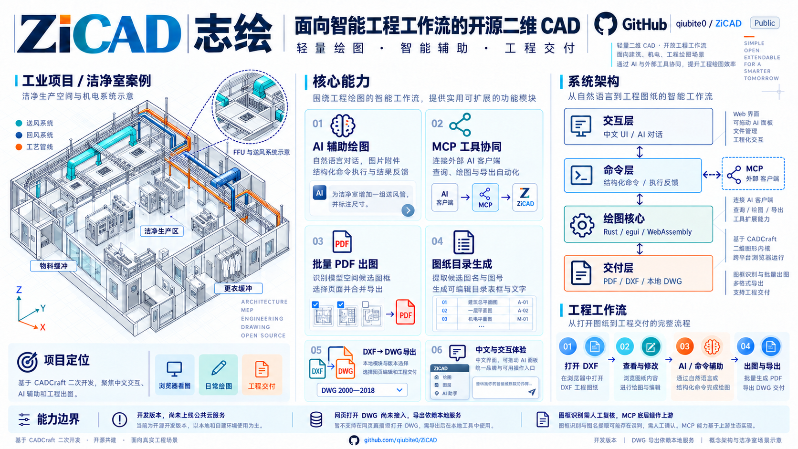
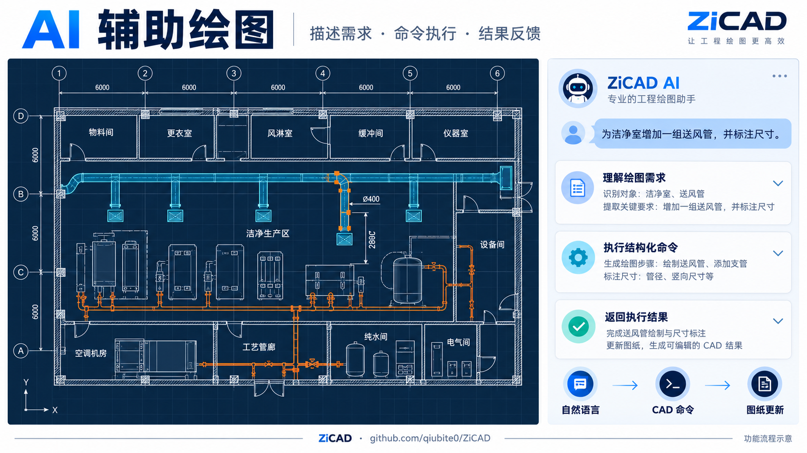
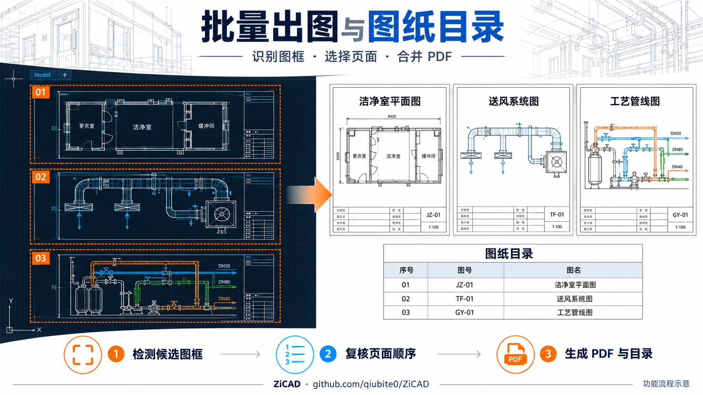
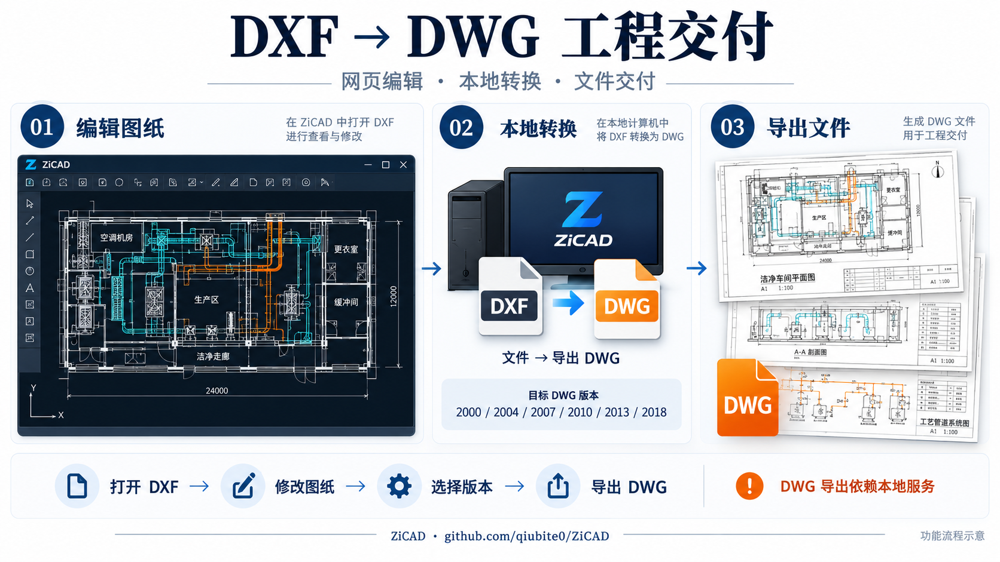
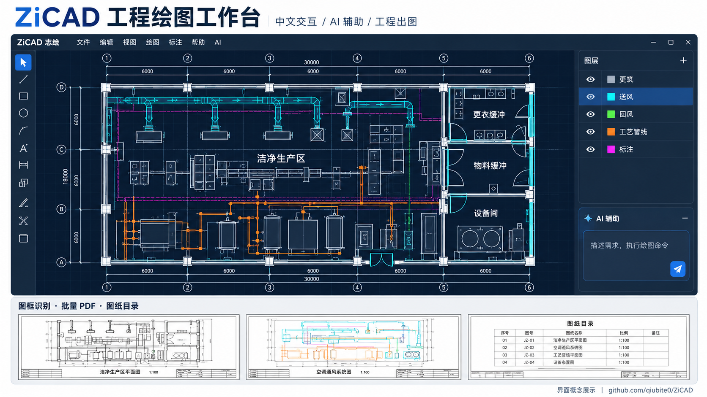

# ZiCAD（志绘）

**Lightweight CAD. Intelligent Workflow. Open by Design.**
**轻量绘图，智能协同，开放扩展。**

ZiCAD 是基于 [CADCraft](https://github.com/storytold/cadcraft) 二次开发的开源二维 CAD 项目。面向浏览器看图、日常改图和工程出图，在上游 Rust / egui / WebAssembly 核心之上，重点增加了**内置 AI 助手、图框识别与批量 PDF 出图、图纸目录生成、本地 DXF→DWG 导出，以及中文界面和网页体验改进**。

> 当前是本地可运行的开发版本，尚未上线公共云服务。基础几何、编辑器核心、原生 DWG 桥接和 MCP 底层来自上游；本文明确区分继承能力、二开增量和未来规划。

## 项目全景：以工业洁净室为场景



### 从工业场景理解项目定位

以洁净生产区、更衣缓冲区、物料缓冲区及送回风、工艺管线为例，工程人员需要反复查看平面图、修改对象与文字、整理图层和图签，最后输出可交付图纸。ZiCAD 围绕这些二维绘图任务，将中文交互、AI 命令辅助和工程出图组织到同一工作流中。

图中的 FFU、管线与空间布局仅作场景展示，不构成施工设计依据。实际使用时，需要导入或绘制项目自己的 DXF 图纸，并由专业人员核对尺寸、系统和图签信息。

### 六项能力如何配合

| 模块 | 对应操作 | 使用边界 |
|---|---|---|
| AI 辅助绘图 | 描述修改需求，附加参考图片，执行结构化命令并反馈结果 | 依赖所配置模型；生成结果需复核 |
| MCP 工具协同 | 外部 AI 客户端调用查询、绘图和导出工具 | 主要面向原生 CLI / 桌面桥接，底层继承上游 |
| 批量 PDF 出图 | 检测候选图框，选择页面并合并输出 | 需人工检查图框与出图顺序 |
| 图纸目录生成 | 提取候选图名、图号等字段，生成可编辑目录 | 不是 OCR，复杂图签仍需人工调整 |
| DXF → DWG 导出 | 将当前图纸交由本地转换器导出 | 目标版本为 2000、2004、2007、2010、2013、2018 |
| 中文与交互体验 | 使用中文界面、可拖动 AI 面板和统一功能入口 | UI 字体与图纸正文文字需分别验证 |

### 四层协同架构

- **交互层**：中文界面、AI 对话与工程操作入口，收集用户意图。
- **命令层**：以结构化命令执行操作，将成功或失败结果返回对话流程；外部 MCP 客户端通过独立服务入口访问绘图命令核心。
- **绘图核心**：复用上游 Rust / egui / WebAssembly 基础，处理二维实体、图层与编辑状态。
- **交付层**：组织 PDF 出图、DXF 文件操作与依赖本地服务的 DWG 转换。

以上是职责划分示意，不代表浏览器可以直接连接原生 MCP，或具备公共云端转换服务。

### 一次工程交付流程

1. **打开 DXF**：载入实际工程图，检查单位、图层和文字显示。
2. **查看与修改**：调整二维对象、标注、文字与图签内容。
3. **AI / 命令辅助**：描述具体操作，复核命令与执行结果；需要外部自动化时配置 MCP 服务。
4. **出图与导出**：复核候选图框，生成图纸目录与批量 PDF；需要 DWG 时启动本地转换服务后导出，并在目标 CAD 中读回检查。

项目仍处于开发阶段，尚未上线公共云服务，网页直接打开 DWG 尚未接入。详细实现与限制见下文各模块说明。

## 项目愿景：专业绘图，不必复杂

日常工程工作中的高频任务，往往是查看图纸、修改对象与标注、整理图层、按图框出图、生成目录，再导出便于交付的文件。ZiCAD 希望将这些操作组织成更直接的工作流，让用户从“打开工具”更快地走向“完成任务”。

我们相信，专业工具应认真对待精度，也应降低安装、学习和重复操作的负担。轻量不意味着简陋，开放不意味着妥协；同时，轻量也不意味着所有文件都能瞬时处理，或完全不需要后台计算资源。

## 二次开发重点

| 方向 | ZiCAD 增量 | 当前边界 |
|---|---|---|
| AI 辅助绘图 | 内置对话、模型配置、图片附件、命令执行与结果反馈、自动/确认执行、停止和续轮控制 | 模型能力依赖服务商；预设目录不等于每个模型都已验证 |
| 工程批量出图 | 模型空间图框候选识别、勾选页面、每框一页、合并 PDF | 启发式识别，需复核；不是向系统打印机批量派单 |
| 图纸目录 | 提取图名、图号、版别等候选字段，生成可编辑的目录线框和文字 | 非 OCR；复杂块图签和异形图框仍需扩展 |
| DWG 交付 | 网页新增“文件 → 导出 DWG…”，当前图纸交由本地 Rust 转换器导出 | 依赖配套本地服务；网页直接打开 DWG 尚未接入 |
| MCP 自动化整合 | 保留并适配上游 MCP 入口，与同一命令核心配合查询、绘图和导出 | 协议和主要工具继承上游，不能表述为全部从零原创 |
| 中文与网页体验 | 简繁中文扩展、UI 字体、ZiCAD 品牌、面板拖动、帮助右侧入口、宿主嵌入与构建资源复制 | 图纸正文中文与 UI 字体走不同路径，需进一步验证 |

### AI：从聊天走向可执行的绘图辅助



AI 助手接收用户的绘图或修改描述，并结合当前图纸的基本信息组织请求。模型按照约定返回命令时，ZiCAD 将命令交给 CAD 命令系统执行，再把成功或失败结果反馈给模型，形成：

**描述需求 → 生成命令 → 执行 → 返回结果 → 继续或总结。**

- 可配置 OpenAI 兼容端点、模型名称、API Key、温度和最大续轮数。
- 提供多平台预设，也可填写自定义端点；实际可用模型以服务商结果为准。
- 可附加最多四张图片，交给支持视觉输入的模型。
- 可选择自动执行或人工确认后执行，支持停止等待。
- AI 面板可通过标题栏拖动，入口位于“帮助”右侧。
- 已在真实浏览器中验证 DeepSeek 对话、发送按钮、Ctrl+Enter 和配置刷新保留。

内置 AI 的命令执行与 MCP 是两条不同入口，它们复用绘图命令核心，不能把内置聊天面板直接称为浏览器 MCP 客户端。

对话、必要图纸上下文和用户附加图片会发送到所配置的模型服务。当前 Key 保存在浏览器本机设置中；公共部署需要重新设计凭据、权限和额度管理。

### 打印：按图框组织工程出图



新增工程出图模块，面向同一模型空间包含多个图框的场景。它先识别候选图框与图签文字，再由用户选择需要处理的图纸。

- **批量 PDF**：每个选中图框对应一页，合并导出为多页 PDF。
- **页面复核**：可刷新检测、全选或取消选择，应检查图框候选和顺序。
- **图纸目录**：将序号、图名、图号、版别绘制在图框右侧；通过普通 CAD 命令生成，可以继续编辑，并进入撤销历史。

图框识别基于闭合多段线尺寸和文本位置等规则。建筑轮廓等矩形也可能被识别为候选；复杂块图签、异形图框和不同比例图纸需继续扩展。它不是通用识图模型，也不替代施工图审校。

### DWG：连接网页编辑与工程交付



打开 DXF 后，点击 **文件 → 导出 DWG…** 下载当前图纸。支持 2000、2004、2007、2010、2013、2018 目标版本，取值来自“默认保存版本”。

转换复用原生 Rust DWG 桥接和 `cadcraft-cli`，在本地开发服务中完成，不调用第三方付费转换平台。导出不会改写当前图纸名称，也不会清除未保存标记。

转换接口设置 64 MiB 输入限制、两个并发任务和 120 秒超时，并清理临时文件。真实网页下载的示例 DWG 已读回验证：2018 版本、155 个实体、未跳过记录。这是示例验证结果，不是任意 DWG 或行业代理对象无损兼容的承诺。

### MCP：让外部代理访问绘图核心

ZiCAD 保留并适配上游 MCP 服务，可连接外部 AI 客户端，以结构化工具执行绘图、查询和导出任务。

| 工具 | 用途 |
|---|---|
| `command_line` / `script` | 命令行输入与多行脚本 |
| `execute` / `list_commands` | JSON 命令执行与命令目录查询 |
| `inspect_drawing` / `query_entities` | 查询图纸、实体、图层及范围 |
| `find_text` / `render` | 提取图中文字、生成图形预览 |
| `open` / `save` / `cancel` | 文件操作和取消命令 |
| `screenshot` / `ui_inspect` / `ui_click` | 连接原生应用时提供的部分 UI 工具 |

MCP 主要面向原生命令行和桌面桥接环境。当前没有浏览器多用户远程 MCP 服务。底层工具集由上游提供，ZiCAD 的价值在于将其保留到自有工程工作流中，并为后续专业化工具扩展提供统一入口。

## 为轻量化而生

1. **即开即用**：以浏览器为主要编辑入口，减少安装和环境配置负担。
2. **专注高频任务**：围绕看图、改图、图层、标注、目录和出图组织功能。
3. **开放架构**：命令核心同时服务于 UI、脚本、AI 辅助与外部 MCP。
4. **可导出与可迁移**：保留开放文件工作流，减少用户对单一平台的依赖。

## 演进路线与商业化方向

| 阶段 | 内容 | 状态 |
|---|---|---|
| 本地工程工作流 | 浏览器编辑、AI 对话、图框出图、图纸目录、DWG 导出 | 已有实现，持续回归 |
| 可部署网站 | 登录、HTTPS、凭据管理、限流、文件隔离和后台任务 | 待建设 |
| 个人工作空间 | 云存储、项目组织、历史版本和跨设备访问 | 规划 |
| 团队协作 | 分享、权限、审阅批注和团队工作区 | 规划 |
| 智能工程生态 | 更多图签规则、专业助手、插件/API 和 CAD/BIM 数据交互 | 研究与规划 |

延续“核心开放，服务增值”的方向，未来可探索以下产品形态：

| 产品 | 定位 | 发展方向 |
|---|---|---|
| ZiCAD Core | 开源二维 CAD 核心与工作流扩展 | 免费开源 |
| ZiCAD Web | 浏览器编辑入口 | 基础在线服务 |
| ZiCAD Pro | 个人设计工作空间 | 可选订阅 |
| ZiCAD Team | 团队图纸管理与协作 | 团队服务 |
| ZiCAD Enterprise | 企业部署、集成与管理 | 商业服务 |

上述云服务、订阅和团队功能尚未上线，也不构成当前版本的可用性承诺。商业服务应围绕存储、管理、协作和效率提供价值，同时尊重用户对图纸的控制权。

## 当前限制

- 网页 DWG 导入未实现；DWG 导出需要配套服务。
- 尚未完成公网部署、多用户权限、生产级密钥管理和文件隔离。
- 图框识别需人工复核；PDF 生成测试不等于覆盖所有网页多页交互。
- 图纸正文中文字体、天正/行业代理对象、动态块及复杂图签需更多兼容性测试。
- 不宣称完整替代 AutoCAD，不提供 Revit/BIM 三维建模能力。

## 来源与致谢

ZiCAD 基于 CADCraft 二次开发，保留原项目版权、MIT / Apache-2.0 许可证和 NOTICE。`acadrust` 作为未修改依赖提供原生 DWG 能力，其许可信息见 NOTICE。新增字体及演示资产单独列入素材清单。

ArtCraft 商标图案不作为 ZiCAD 的品牌素材，上传包排除其专有商标图片，保留相关许可证说明。内部 Rust crate 名、部分协议和存储键暂保留 `cadcraft` 标识，以保证兼容性。

**ZiCAD：志于创造，成于设计。**

## English summary

ZiCAD is an open-source 2D CAD project derived from CADCraft. It connects browser-based editing with an integrated AI assistant, title-block-based PDF output, editable sheet indexes and locally serviced DXF-to-DWG export. The Rust CAD core, native DWG bridge and MCP foundation are inherited from upstream. Cloud workspaces, collaboration and commercial subscriptions remain future directions.

## 本地构建与运行

需要 Rust 1.95 或以上、Rust WASM 目标、Trunk 和 Python 3.10 或以上。Windows 还需要 MSVC 链接环境。首次构建可能下载依赖；推荐使用两个构建任务。

```sh
rustup target add wasm32-unknown-unknown
cargo build -p cadcraft-cli -j 2
cd apps/cadcraft-web
trunk build
cd ../..
python tools/dev-proxy.py
```

访问 `http://127.0.0.1:8771/host.html?file=mep-coordination.dxf`。先完成网页构建后，Windows 用户也可运行 `tools/run-local.ps1`。

开发服务同时提供静态网页、AI 同源转发和 DWG 转换。`trunk serve` 无法替代这两个后台接口。默认转换器在 `target/debug/cadcraft-cli.exe`（Windows）或 `target/debug/cadcraft-cli`，可用 `CADCRAFT_CLI` 指向其他构建路径。

如 Trunk 报 `NO_COLOR=1` 无效，可在当前终端设为 `true`；如找不到 wasm-bindgen，应安装/指定与 Cargo.lock 匹配的版本。不要把开发者电脑上的绝对工具路径写入发布脚本。

### 专项测试

```sh
cargo test -p cadcraft-ui-egui --test ai_chat_window --test frames_flow --test dwg_export -j 2
python tools/test_dwg_conversion.py
```

上述测试不需要真实 AI Key；需要访问真实模型的测试使用环境变量，并单独标为忽略。

### MCP 配置示例

```json
{
  "mcpServers": {
    "zicad": {
      "command": "/absolute/path/to/cadcraft-cli",
      "args": ["mcp"]
    }
  }
}
```

将 command 换成实际转换器/CLI 路径（Windows 为 `.exe`）。`mcp` 默认创建独立无头会话；连接桌面应用需先以 `--control 7979` 启动，再设置 `mcp --connect 127.0.0.1:7979`。这不会直接连接当前网页画布。

## 源码与发布材料

- [二次开发说明](docs/二次开发说明.md)
- [源码与文件上传清单](docs/源码与文件上传清单.md)
- [发布检查与已知边界](docs/发布检查.md)
- [MCP 接口](docs/mcp.md)
- [DWG 导出](docs/dwg-export.md)
- [素材清单](ATTRIBUTION.md)、[版权与依赖说明](NOTICE)
- [MIT](LICENSE-MIT) / [Apache-2.0](LICENSE-APACHE)

## 功能配图


