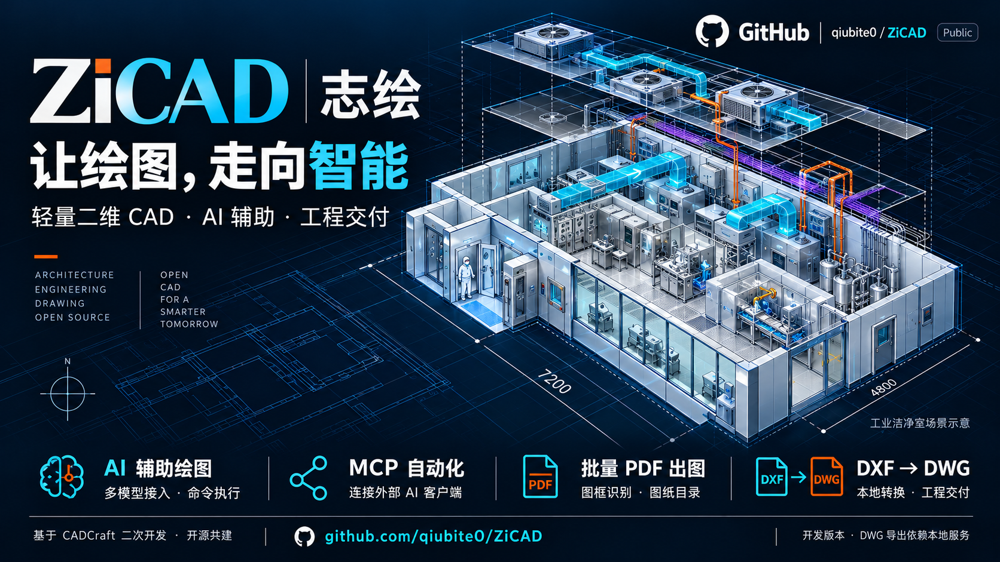
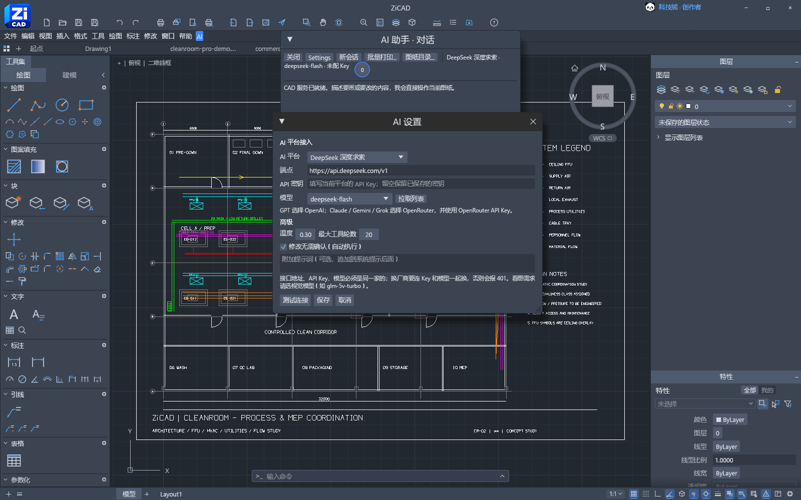
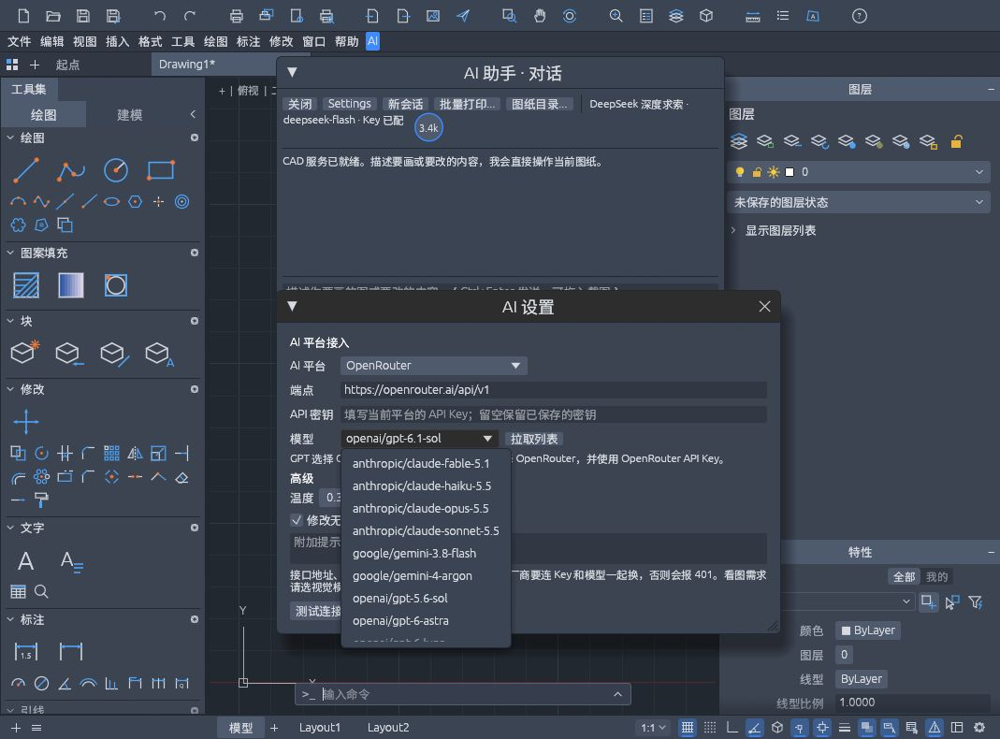
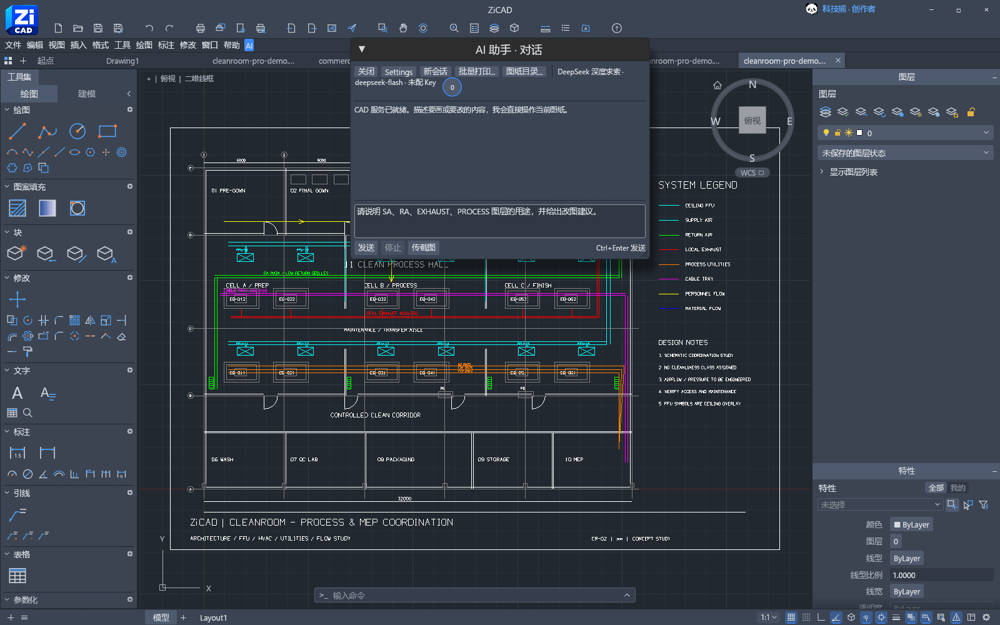
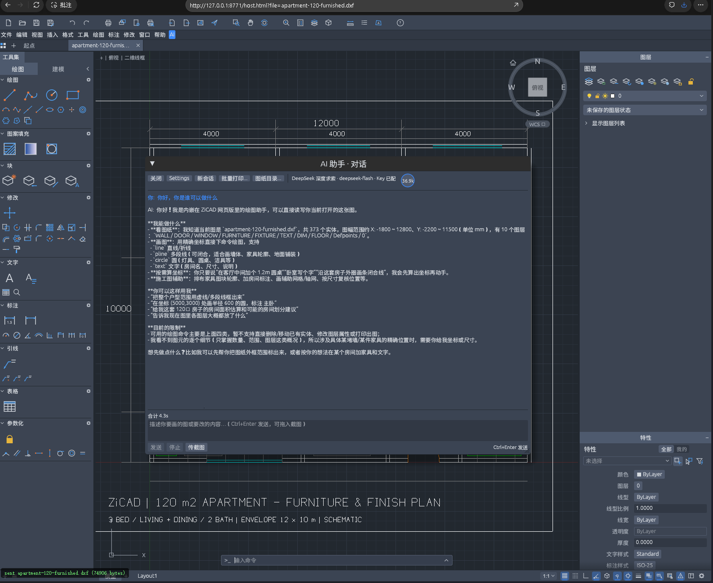
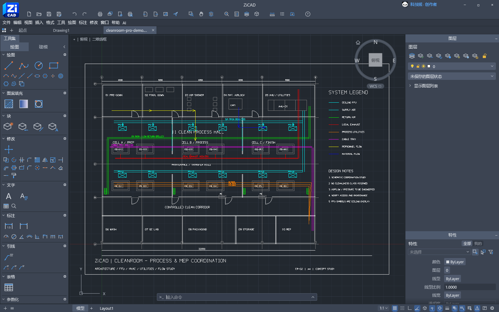
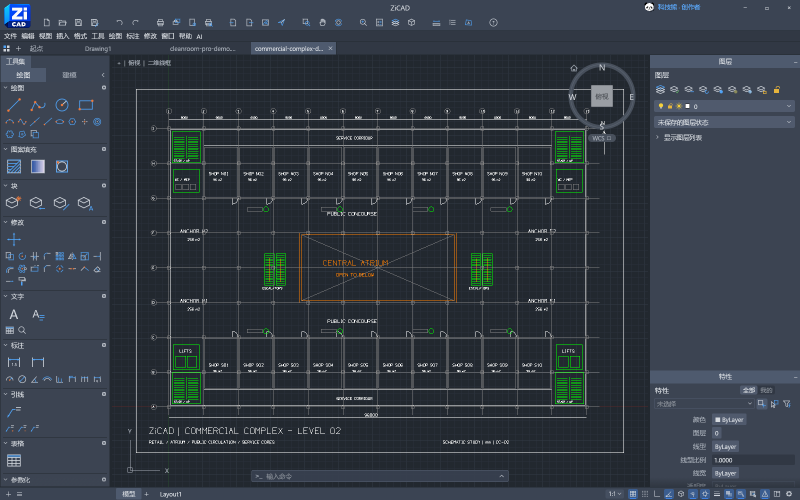
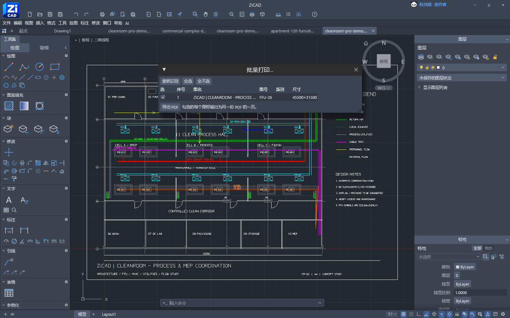
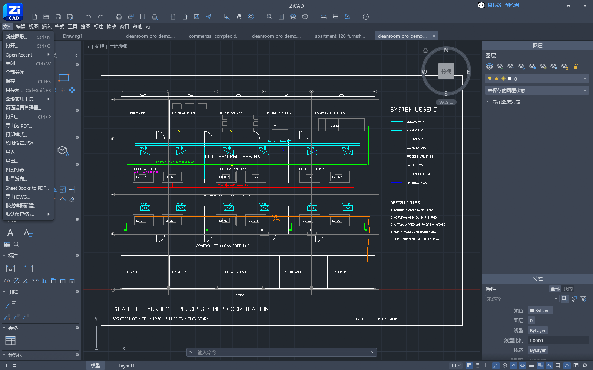

<h1 align="center">ZiCAD · 志绘</h1>
<p align="center"><strong>轻量二维 CAD · AI 辅助 · 工程出图</strong></p>
<p align="center">
  <a href="#ai-辅助与模型接入">AI 辅助</a> ·
  <a href="#工程案例">工程案例</a> ·
  <a href="#核心功能">核心功能</a> ·
  <a href="#技术架构">技术架构</a> ·
  <a href="#本地构建与运行">本地运行</a> ·
  <a href="docs/mcp.md">MCP 文档</a>
</p>

ZiCAD 是面向工程绘图与交付的开源二维 CAD。以浏览器为绘图入口，将中文交互、AI 命令辅助、图框识别、批量 PDF、图纸目录及本地 DXF → DWG 导出串联起来，面向看图、改图和工程交付。

**打开 DXF → 查看与修改 → AI / 命令辅助 → 图框与目录 → PDF / DWG 交付**

## AI 辅助与模型接入

### 大模型接口配置



在 **AI → Settings** 中选择平台，填写同一服务商的接口端点、API Key 与模型名称，再点击“测试连接”或“拉取列表”。上图为 DeepSeek 实际连接测试，密钥以遮蔽形式显示。

| 配置 | 用途 |
|---|---|
| AI 平台与端点 | 支持预设平台和自定义 OpenAI 兼容地址，也可接入本地 Ollama |
| API Key | 按平台分别保存；切换厂商时需使用对应凭据 |
| 模型 | 从预设或接口返回的列表选择，图像附件需使用视觉模型 |
| 温度与工具轮数 | 调整回答采样和命令执行续轮上限 |
| 自动执行与附加提示词 | 设置执行确认方式，补充任务约束 |

预设包括 OpenAI、DeepSeek、智谱 GLM、Kimi、通义千问、豆包、硅基流动和 OpenRouter。海外模型可直接在下拉列表选择：

| 模型系列 | 预设示例 | 选择平台 |
|---|---|---|
| GPT | GPT-6.1 Sol、GPT-6 Astra / Sol / Luna、GPT-5.6 Sol、GPT-4.1 | OpenAI，或 OpenRouter |
| Claude | Sonnet 5.5、Opus 5.5、Haiku 5.5、Fable 5.1 | OpenRouter |
| Gemini | Gemini 4 Argon、Gemini 3.8 Flash | OpenRouter |
| Grok | Grok 4.7 | OpenRouter |



这里的预设是模型名称与接口配置，不包含模型权重或调用额度。Claude / Gemini / Grok 使用 OpenRouter API Key；不是直接使用厂商原生 Key。网页通过配套本地服务同源转发请求，可用性取决于服务商与账号权限，也可点击“拉取列表”更新目录。

模型参考：[OpenAI 官方模型目录](https://developers.openai.com/api/docs/models) · [OpenRouter 模型目录](https://openrouter.ai/models)。

### AI：让描述进入绘图流程

**描述需求 → 生成命令 → 执行 → 返回结果 → 继续或总结。**

- 支持 OpenAI 兼容端点、自定义模型、API Key、温度与最大续轮数配置。
- 最多附加四张图片，供支持视觉输入的模型使用。
- 支持自动执行或确认后执行，可停止等待；使用 **Ctrl+Enter** 发送。
- AI 面板入口位于“帮助”右侧，可通过标题栏拖动。

对话、必要图纸上下文和附件会发送至所配置的模型服务，API Key 保存在浏览器本机设置中。模型与命令执行结果应按任务复核。



**实测演示**：向已配置的 DeepSeek 提问，要求用四行说明 SA、RA、EXHAUST、PROCESS 图层用途。截图展示实际返回内容，此轮未执行图纸修改。

### 户型图中的 AI 上下文问答



在三室两厅两卫的精装平面方案中，DeepSeek 根据当前图纸的上下文说明可用绘图操作，并返回文件名、**373 个实体、10 个图层**及图纸坐标范围等信息。用户可继续提出房间文字、家具轮廓或指定坐标处的绘图需求，由命令核心承接后续操作。

这张截图展示的是实际问答与上下文识别，没有执行家具调整或图纸修改。模型接收到的是实体统计、图层等概要信息；精确定位仍需坐标、尺寸或参考图片。

底图按 **12×10 米外轮廓约 120㎡**布置，包含三间卧室、客餐厅、双卫、厨房、玄关和洗衣阳台，以及门窗、家具、厨卫洁具与尺寸文字，可继续在 CAD 中编辑。

[下载户型 DXF](examples/apartment-120-furnished.dxf) · [查看生成脚本](tools/generate_apartment_120.py) · [查看完整平面图](docs/images/zicad-apartment-120-live.png)

本地演示地址：`http://127.0.0.1:8771/host.html?file=apartment-120-furnished.dxf`。

## 工程案例

以下图像均为 ZiCAD 网页实际运行截图，对应 DXF 和生成脚本一并开放，可下载、修改并复现。

### 洁净室：工艺与机电综合



以 **32×24 米洁净室**为场景，将建筑空间、生产设备、天花 FFU、机电管线和流线组织到一张分层二维图中。

| 组成 | 图纸内容 |
|---|---|
| 空间组织 | 初更、二更、风淋、物料气闸、机房、三个生产单元、受控走廊、清洗、质检、包装及储存空间 |
| 设备与天花 | 12 台编号设备、12 个编号 FFU、传递窗及低位回风口符号 |
| 机电系统 | 送风、回风、局部排风、PCW / CDA / N2 工艺介质和电缆桥架 |
| 图纸表达 | 人流与物流箭头、柱网轴号、尺寸、系统图例和图纸编号 |
| 可演示操作 | 按图层查看专业内容，编辑实体与文字，执行 AI / 脚本命令，组织出图与导出 |

[下载洁净室 DXF](examples/cleanroom-pro-demo.dxf) · [查看生成脚本](tools/generate_cleanroom_pro_demo.py)

### 商业综合体：商业二层建筑底图



以 **96×64 米商业二层**为场景，展示大平面中的商铺划分、公共交通与后勤组织。

- **商业空间**：20 间商铺、4 个主力店区及中央中庭。
- **交通组织**：环形公共走道、两组扶梯、四角楼梯、电梯及后勤走道。
- **图层组织**：墙体、玻璃、柱网、核心筒、家具、文字及尺寸分别管理。
- **演示用途**：建筑底图查看、局部修改、图层整理和工程出图。

[下载商业综合体 DXF](examples/commercial-complex-demo.dxf) · [查看生成脚本](tools/generate_commercial_demo.py)

两个案例均为原创合成工程示意，采用英文图纸标注以适配当前网页字体。洁净室风量、压差、洁净等级与商业项目规范条件需在实际设计中另行确定。

### 本地打开案例

完成下方构建与启动后，选择对应地址：

| 案例 | 本地地址 |
|---|---|
| 洁净室深化图 | `http://127.0.0.1:8771/host.html?file=cleanroom-pro-demo.dxf` |
| 商业综合体底图 | `http://127.0.0.1:8771/host.html?file=commercial-complex-demo.dxf` |

生成脚本依赖 `ezdxf`，通过 `python -m pip install ezdxf` 安装后，可重新生成或调整示例。上述底图同时保存在网页宿主资源目录，构建后可直接加载。

## 核心功能

| 方向 | ZiCAD 提供的功能 |
|---|---|
| AI 辅助绘图 | 内置对话、端点与模型配置、图片附件、结构化命令执行及结果反馈 |
| 工程批量出图 | 检测模型空间候选图框、勾选页面、每框一页并合并 PDF |
| 图纸目录 | 提取候选图名、图号和版别，生成可编辑的目录线框与文字 |
| DWG 交付 | 将当前 DXF 图纸通过本地转换服务导出为指定 DWG 版本 |
| MCP 自动化 | 保留并适配上游 MCP 服务，对外提供查询、绘图、脚本和导出工具 |
| 中文与网页交互 | 简繁中文界面、可拖动 AI 面板、帮助菜单右侧入口及网页宿主集成 |

### 出图：从图框到 PDF 与目录

在同一模型空间放置多张图纸后，检测候选图框，检查页面与顺序，再输出多页 PDF。图纸目录将序号、图名、图号和版别绘制为普通 CAD 对象，可继续编辑并进入撤销历史。

图框识别依据闭合轮廓尺寸和文字位置等规则，复杂块图签与异形图框仍需手动调整。



**实测演示**：识别洁净室底图的闭合外框，选中后导出单页 PDF。图框与图签字段仍需复核；多图框图纸可勾选多页合并输出。

### DWG：连接编辑与工程交付

打开 DXF 后，选择 **文件 → 导出 DWG…**。支持 **2000、2004、2007、2010、2013、2018** 目标版本，取值来自“默认保存版本”。

转换使用本地 Rust DWG 桥接与 `cadcraft-cli`，接口限制为 64 MiB 输入、两个并发任务和 120 秒超时，任务结束清理临时文件。详细配置见 [DWG 导出文档](docs/dwg-export.md)。

1. 打开或编辑 DXF 图纸。
2. 在 **文件 → 默认保存格式** 中选择目标 DWG 版本。
3. 点击 **文件 → 导出 DWG…**，由本地服务完成转换并下载。
4. 在目标 CAD 中打开导出文件，核对实体、文字和图层。




**实测演示**：从网页导出洁净室 DWG；同一转换服务生成的 2018 示例文件已读回验证，共 600 个实体、跳过记录为 0。

[下载 DWG 导出示例](docs/demo/cleanroom-pro-demo.dwg) · [查看对应 DXF](examples/cleanroom-pro-demo.dxf) · [查看导出菜单截图](docs/images/zicad-cleanroom-dwg-live.png)

### MCP：连接外部 AI 客户端

通过原生 CLI / 桌面桥接提供结构化工具，与内置 AI 面板复用绘图命令核心。

| 工具 | 用途 |
|---|---|
| `command_line` / `script` | 命令行与多行脚本 |
| `execute` / `list_commands` | JSON 命令执行与命令查询 |
| `inspect_drawing` / `query_entities` | 图纸、实体及图层查询 |
| `find_text` / `render` | 文字提取与图形预览 |
| `open` / `save` / `cancel` | 文件操作与命令取消 |
| `screenshot` / `ui_inspect` / `ui_click` | 连接原生应用时的 UI 工具 |

配置和连接方式见 [MCP 文档](docs/mcp.md)。浏览器内置 AI 对话与外部 MCP 是独立入口。

## 技术架构

| 层次 | 职责 |
|---|---|
| 中文界面与 AI 交互 | 组织绘图操作、模型设置、工程出图和用户输入 |
| 命令与会话 | 结构化命令执行、编辑状态及执行结果反馈 |
| 二维绘图核心 | Rust / egui / WebAssembly，处理实体、图层与绘图交互 |
| 文件与工具服务 | DXF、PDF、原生 DWG 转换及 MCP 接口 |

ZiCAD 的二开重点是 AI 与工程工作流、中文交互和网页集成；基础绘图核心、原生 DWG 桥接及 MCP 底层继承自 CADCraft。

## 当前状态与后续方向

当前为本地可运行的开发版本。网页直接打开 DWG 尚未接入，DWG 导出依赖本地服务；中文 UI 与图纸正文采用不同字体路径，图纸中文显示仍在完善。

后续重点包括复杂图签与图框适配、图纸字体和文件兼容性、工程命令扩展，以及网站部署与多人使用所需的权限和文件隔离。完整记录见 [发布检查与已知边界](docs/发布检查.md)。

## 来源与许可

基于 [CADCraft](https://github.com/storytold/cadcraft) 二次开发，保留原项目版权和 [MIT](LICENSE-MIT) / [Apache-2.0](LICENSE-APACHE) 许可证。原生 DWG 依赖及其他许可信息见 [NOTICE](NOTICE)，Logo、字体与演示素材来源见 [ATTRIBUTION.md](ATTRIBUTION.md)。内部部分 crate、协议和存储键保留 `cadcraft` 名称以保持兼容。

## Windows 免安装包

桌面程序可打包为 ZIP，完整解压后运行 `ZiCAD.exe`。包内包含原生命令行工具、示例 DXF 和许可证；AI 使用用户自己的模型接口与 Key，桌面 DWG 导出不依赖网页服务。

开发者可在 Windows x64 环境运行：

```powershell
./tools/package-portable.ps1 -RuntimeDir "<Visual Studio VC Redist 的 x64 CRT 目录>"
```

脚本编译发布版并生成 `dist/portable` 中的预览 ZIP。运行库目录应指向已安装 Visual Studio 的可再分发 CRT 文件夹；若省略，该包要求目标电脑已有相应 VC++ 运行库。包中不复制开发者配置或私人凭据，程序配置默认位于 `%APPDATA%\ZiCAD`。

## 本地构建与运行

需要 Rust 1.95 或以上、Rust WASM 目标、Trunk 和 Python 3.10 或以上。Windows 还需要 MSVC 链接环境。首次构建可能下载依赖；推荐使用两个构建任务。

```sh
rustup target add wasm32-unknown-unknown
cargo build -p cadcraft-cli -j 2
cd apps/cadcraft-web
trunk build
cd ../..
python tools/dev-proxy.py
```

访问 `http://127.0.0.1:8771/host.html?file=mep-coordination.dxf`。先完成网页构建后，Windows 用户也可运行 `tools/run-local.ps1`。

开发服务同时提供静态网页、AI 同源转发和 DWG 转换。`trunk serve` 无法替代这两个后台接口。默认转换器在 `target/debug/cadcraft-cli.exe`（Windows）或 `target/debug/cadcraft-cli`，可用 `CADCRAFT_CLI` 指向其他构建路径。

如 Trunk 报 `NO_COLOR=1` 无效，可在当前终端设为 `true`；如找不到 wasm-bindgen，应安装/指定与 Cargo.lock 匹配的版本。不要把开发者电脑上的绝对工具路径写入发布脚本。

### 专项测试

```sh
cargo test -p cadcraft-ui-egui --test ai_chat_window --test frames_flow --test dwg_export -j 2
python tools/test_dwg_conversion.py
```

上述测试不需要真实 AI Key；需要访问真实模型的测试使用环境变量，并单独标为忽略。

### MCP 配置示例

```json
{
  "mcpServers": {
    "zicad": {
      "command": "/absolute/path/to/cadcraft-cli",
      "args": ["mcp"]
    }
  }
}
```

将 command 换成实际转换器/CLI 路径（Windows 为 `.exe`）。`mcp` 默认创建独立无头会话；连接桌面应用需先以 `--control 7979` 启动，再设置 `mcp --connect 127.0.0.1:7979`。这不会直接连接当前网页画布。

## 源码与发布材料

- [二次开发说明](docs/二次开发说明.md)
- [源码与文件上传清单](docs/源码与文件上传清单.md)
- [发布检查与已知边界](docs/发布检查.md)
- [MCP 接口](docs/mcp.md)
- [DWG 导出](docs/dwg-export.md)
- [素材清单](ATTRIBUTION.md)、[版权与依赖说明](NOTICE)
- [MIT](LICENSE-MIT) / [Apache-2.0](LICENSE-APACHE)
