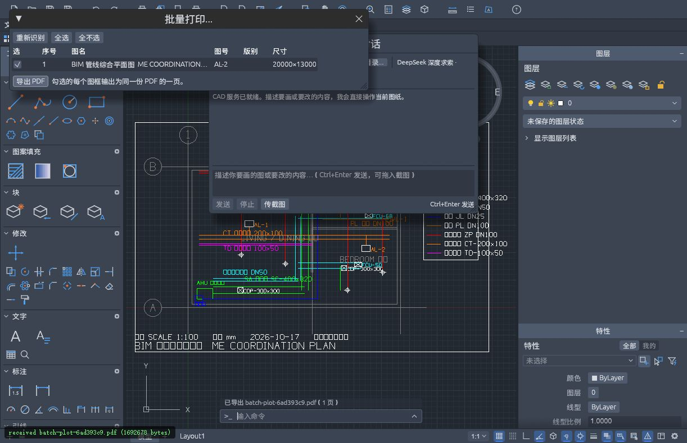
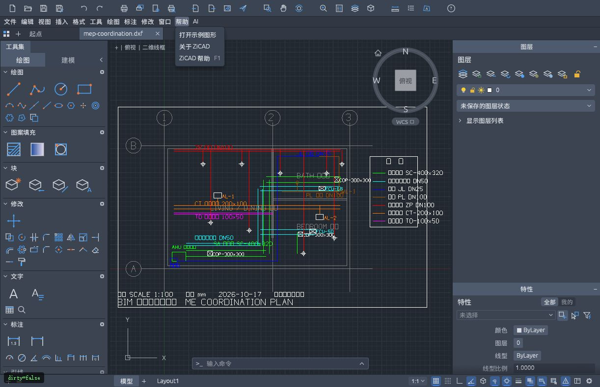

# ZiCAD（志绘）

**轻量绘图 · 智能辅助 · 工程交付**

ZiCAD 是基于 [CADCraft](https://github.com/storytold/cadcraft) 二次开发的开源二维 CAD，面向浏览器看图、日常改图和工程出图，增加了内置 AI 助手、批量 PDF、图纸目录、DXF → DWG 导出及中文交互。


## 核心功能

| 功能 | 内容 |
|---|---|
| AI 辅助绘图 | 自然语言对话、图片附件、结构化命令执行与结果反馈，支持自动或确认执行 |
| MCP 工具协同 | 通过原生 CLI / 桌面桥接连接外部 AI 客户端，调用查询、绘图和导出工具 |
| 批量 PDF 出图 | 识别模型空间候选图框，选择图纸并合并为多页 PDF |
| 图纸目录 | 提取候选图名、图号和版别，生成可继续编辑的目录 |
| DXF → DWG | 通过本地服务导出 2000、2004、2007、2010、2013、2018 版本 |
| 中文交互 | 简繁中文界面、可拖动 AI 面板、帮助菜单右侧的 AI 入口 |

## 使用流程

**打开 DXF → 查看与修改 → AI / 命令辅助 → 生成目录 → PDF 或 DWG 交付**

- **AI**：从“帮助”右侧打开面板，配置模型端点、模型名称和 API Key；支持 Ctrl+Enter 发送。
- **批量出图**：检测图框，检查候选页面与顺序，再生成 PDF 或图纸目录。
- **DWG 导出**：在本地服务运行时，选择 **文件 → 导出 DWG…**。

AI 请求会将对话、必要的图纸上下文和附件发送至所配置的模型服务；API Key 保存在浏览器本机设置中。

## 本地运行

需要 Rust 1.95+、Trunk、Python 3.10+；Windows 需要 MSVC 链接环境。

```sh
rustup target add wasm32-unknown-unknown
cargo build -p cadcraft-cli -j 2
cd apps/cadcraft-web
trunk build
cd ../..
python tools/dev-proxy.py
```

打开 `http://127.0.0.1:8771/host.html?file=mep-coordination.dxf`。完成构建后，Windows 也可使用 `tools/run-local.ps1` 启动。

开发服务提供网页、AI 同源转发和 DWG 转换；单独运行 `trunk serve` 不包含后两个接口。可通过 `CADCRAFT_CLI` 指定转换器路径。

### MCP 配置

```json
{
  "mcpServers": {
    "zicad": {
      "command": "/absolute/path/to/cadcraft-cli",
      "args": ["mcp"]
    }
  }
}
```

将 `command` 换成实际 CLI 路径。连接桌面应用和工具列表见 [MCP 文档](docs/mcp.md)。

### 测试

```sh
cargo test -p cadcraft-ui-egui --test ai_chat_window --test frames_flow --test dwg_export -j 2
python tools/test_dwg_conversion.py
```

## 当前状态

当前为本地开发版本。网页 DWG 导入尚未接入，DWG 导出依赖本地服务；图框识别需复核，复杂图签、行业代理对象及图纸中文字体兼容性仍在完善。部署与兼容性详情见 [发布检查](docs/发布检查.md)。

## 界面预览





## 文档与来源

- [二次开发说明](docs/二次开发说明.md)
- [DWG 导出](docs/dwg-export.md) · [MCP 接口](docs/mcp.md)
- [源码与文件上传清单](docs/源码与文件上传清单.md)
- [素材清单](ATTRIBUTION.md) · [版权与依赖说明](NOTICE)

ZiCAD 继承 CADCraft 的 Rust / egui / WebAssembly 绘图核心、原生 DWG 桥接和 MCP 基础，并保留原项目版权。内部部分 crate 和协议名称保留 `cadcraft` 以兼容现有工具。

采用 [MIT](LICENSE-MIT) / [Apache-2.0](LICENSE-APACHE) 许可证。
