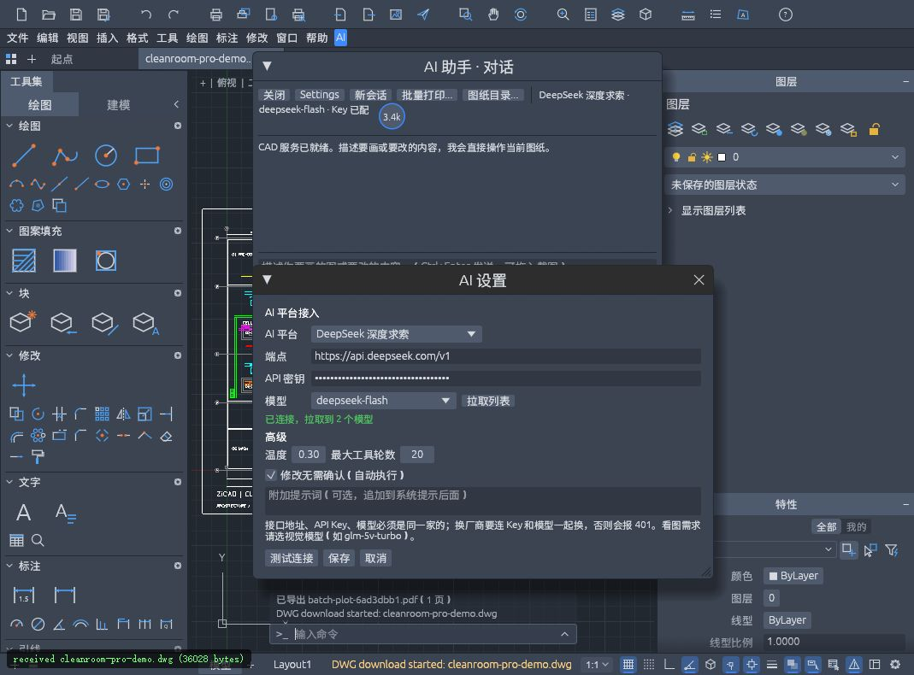
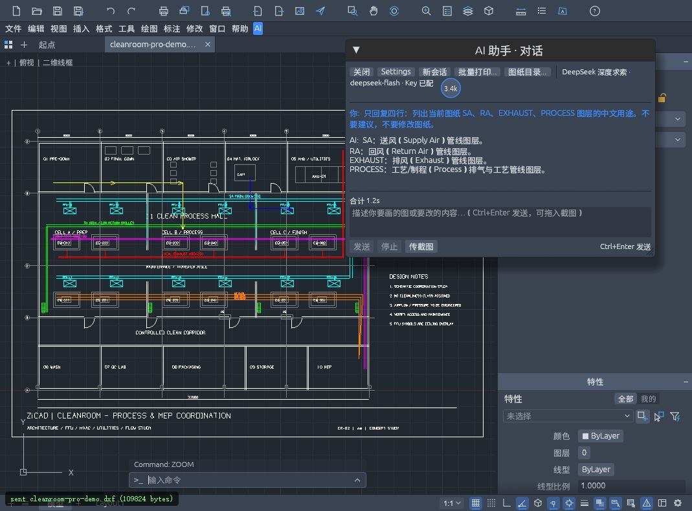
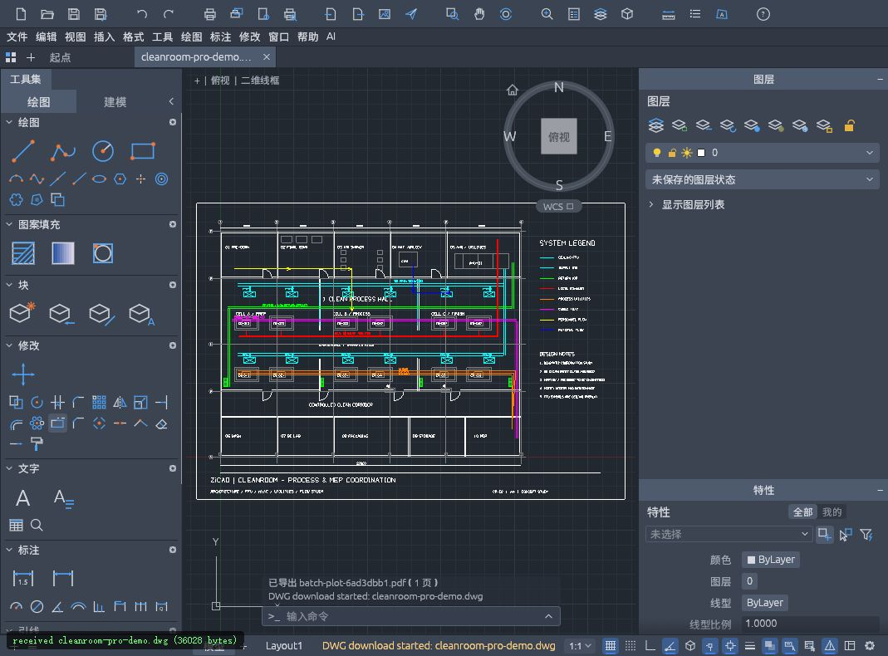

# 历史实测记录

以下为原版本的真实连接、问答和导出记录，保留用于结果追溯；新版产品界面见项目主页。

## 连接测试

## 洁净室问答

DeepSeek 对 SA、RA、EXHAUST、PROCESS 图层的历史实际回复，本轮未执行图纸修改。

## 户型问答

实际回复中包含图纸名称、373 个实体、10 个图层与坐标范围。

## 网页 DWG 导出

网页导出的原始演示截图；对应示例文件曾以 2018 版本读回验证 600 个实体、跳过记录为 0。

